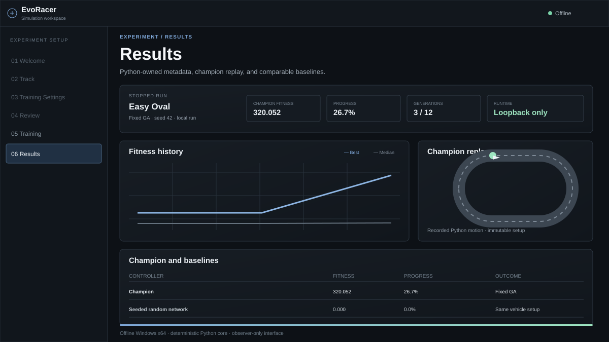

# EvoRacer AI Lab

[](https://github.com/EfeErim/evo-racer-ai-lab/actions/workflows/ci.yml)
[](https://github.com/EfeErim/evo-racer-ai-lab/releases)


A desktop app for watching neuroevolution learn to drive. You build or generate a
track, pick an algorithm (a fixed-topology genetic algorithm or NEAT), press Start,
and watch generations of cars get better at lapping it. You never drive.

It runs fully offline: no accounts, no telemetry, no network calls beyond
`127.0.0.1`.



## Download

Get `EvoRacer-Windows-x64.zip` from the
[latest release](https://github.com/EfeErim/evo-racer-ai-lab/releases/latest),
extract it and run `EvoRacer.exe` (`EvoRacer.cmd` in v1.1.0). Python is bundled, so
nothing needs to be installed. Settings, tracks and saved runs live in
`%LOCALAPPDATA%\EvoRacerAILab`.

The [user guide](docs/user-guide.md) covers tracks, training settings, results and
troubleshooting.

## Features

- **Tracks:** three presets, a piece-by-piece editor, a seeded generator, and
  JSON import/export. Every track goes through the same compiler, which checks
  closure and self-intersection.
- **Simulation:** fixed-step (60 Hz) arcade physics with slip and grip, seven
  ray sensors, and continuous steering, throttle and brake outputs.
- **Learning:** a fixed `10 → 6 → 3` network trained by a genetic algorithm, or
  NEAT via `neat-python`. Each genome also evolves the car's power budget and
  brake/drive bias. Fitness rewards only forward lap progress and lap efficiency.
- **Observation:** live view of the current candidate, fading trails of earlier
  champions, pause/resume/stop, per-generation fitness and champion replay.
- **Persistence:** every run is checkpointed at generation boundaries and can be
  resumed after a restart; resuming reproduces the same results.

## How it works

```text
Browser UI (TypeScript, Vite)  ──JSON over 127.0.0.1──▶  Python core
  views, editor, rendering                                tracks, physics, GA/NEAT,
                                                          fitness, persistence
```

Python is the single source of truth for every domain rule. The TypeScript side only
renders what Python returns, and the two talk through versioned JSON contracts that
both test suites check (`contracts/`). Runs are deterministic for a given seed, which
is what makes resume and replay exact.

More detail is in [architecture](docs/architecture.md). Does the evolution actually
learn, or just get lucky? The [learning benchmark](docs/experiments/learning-benchmark.md)
compares it with random search on the same evaluation budget, and
[algorithm comparison](docs/algorithm-comparison.md) covers GA versus NEAT.

## Development

Requires Windows, Node.js 24 (see `.nvmrc`), npm 11 and Python 3.13.

```powershell
./scripts/setup.ps1   # creates .venv and installs locked dependencies
npm run dev           # Python service on :8765, Vite on :5173
```

| Command                 | What it runs                                                           |
| ----------------------- | ---------------------------------------------------------------------- |
| `npm run check`         | formatting, lint, type checks and unit tests for TypeScript and Python |
| `npm run test:e2e`      | Playwright user flows and accessibility scan                           |
| `npm run build:release` | PyInstaller build into `release\EvoRacer\` plus the ZIP and checksum   |
| `npm run test:release`  | acceptance test of the built package with no Node.js or Python on PATH |

## Project layout

```text
src/                  TypeScript UI: views, controllers, rendering, IPC client
python/src/evo_racer/ Python core: tracks, simulation, evolution, service
python/tools/         benchmarks and experiment scripts
contracts/            JSON fixtures shared by both test suites
tests/, python/tests/ unit tests;  e2e/  Playwright tests
packaging/            PyInstaller spec and third-party notices
docs/                 architecture, user guide, experiments
```

## Limitations

- Windows x64 only.
- The physics is arcade-style, not a vehicle dynamics model.
- Learning results depend on seed, track and budget. The saved benchmarks show that
  selection beats random search under the tested settings, not that every run
  improves or that one algorithm is better in general.
- Release builds are not code-signed, so Windows SmartScreen may warn on first run.

## License

[MIT](LICENSE). Bundled runtime components keep their own licenses; see
[third-party notices](packaging/THIRD-PARTY-NOTICES.txt).
