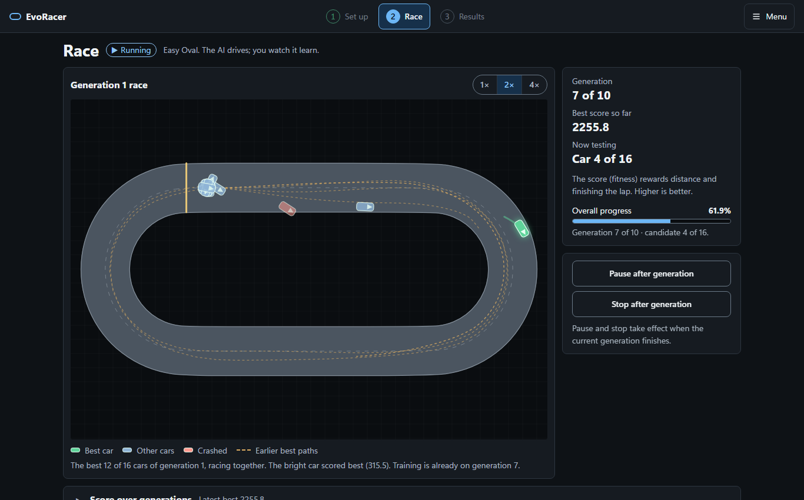
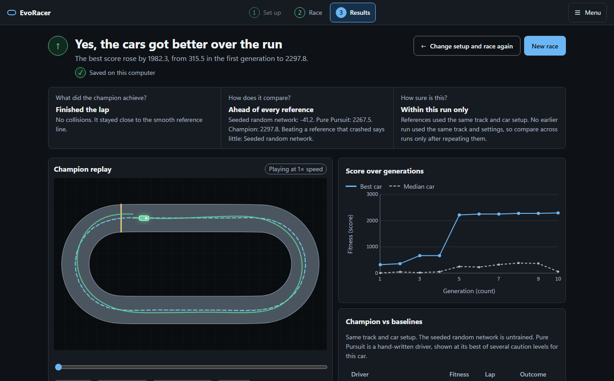

# Demo: captured output

Every block below was produced by running the command, not written by hand. Runs were on
2026-11-09, Windows 11, Python 3.13.5, Node.js 24.13.0, a 12-thread desktop CPU. Setup, source checks
and browser flows ran on a fresh `git clone` of commit `25e8256`; the benchmark runs used
the working checkout at the same commit. Long passing listings are shortened where
marked `[...]`; nothing else is edited.

## Setup

```text
> ./scripts/setup.ps1
[...]
Successfully installed evo-racer-ai-lab-1.1.1
added 137 packages, and audited 138 packages in 3s
[...]
found 0 vulnerabilities
EvoRacer development setup is ready.

real    0m44.531s
```

## Source checks

```text
> npm run check
Checking formatting...
All matched files use Prettier code style!
Checked 10 documents; zero dangling references.

 Test Files  15 passed (15)
      Tests  121 passed (121)

32 files already formatted
All checks passed!
Success: no issues found in 32 source files
============================= test session starts =============================
platform win32 -- Python 3.13.5, pytest-9.1.1, pluggy-1.6.0
collected 166 items
python\tests\test_evolution.py .........                                 [  5%]
[...]
python\tests\test_regression_matrix.py .                                 [ 40%]
[...]
python\tests\test_tracks.py ........                                     [100%]
======================= 166 passed in 111.16s (0:01:51) =======================
vite v8.3.5 building client environment for production...
✓ 38 modules transformed.
dist/index.html                   0.51 kB │ gzip:  0.31 kB
dist/assets/index-eHnAVAOj.css   41.35 kB │ gzip:  7.68 kB
dist/assets/index-zmV5j23q.js   154.67 kB │ gzip: 41.89 kB
✓ built in 83ms

real    2m16.826s
```

## Browser flows

```text
> npm run test:e2e
[1/31] [chromium] › e2e\accessibility.spec.ts:77:3 › every screen has no serious or critical WCAG violations in dark
[...]
[31/31] [chromium] › e2e\ui-standards.spec.ts:269:1 › reduced motion holds still without changing what the run produces
  31 passed (1.6m)

real    1m42.819s
```

## Learning benchmark

All 30 cases (3 presets × 2 algorithms × 5 seeds) are rerun through `RunSession` and
compared with the saved file value by value.

```text
> npm run test:learning
> .venv\Scripts\python python/tools/learning_benchmark.py --fixture contracts/learning-benchmark-v2.json

Verified 30 deterministic cases.

real    3m0.952s
```

One case on its own, NEAT on Technical Circuit with seed 42. The evolved champion
finished the lap; the same number of random cars (160) did not.

```text
> $env:PYTHONPATH = "python/tools"
> .venv\Scripts\python -c "import json, learning_benchmark as b; print(json.dumps(b.run_case('technical-circuit', 'neat', 42), indent=2))"
{
  "presetId": "technical-circuit",
  "algorithm": "neat",
  "seed": 42,
  "firstGenerationBest": 232.35164338,
  "championFitness": 2303.33333333,
  "championProgress": 1.0,
  "championFinished": true,
  "controlFitness": 404.86860118,
  "controlProgress": 0.3373905,
  "controlFinished": false,
  "pursuitFitness": 2242.33333333,
  "pursuitFinished": true,
  "pursuitCrashed": false,
  "randomFitness": 9.59095375
}

real    1m13.133s
```

These values equal the saved entry for that case in
[`contracts/learning-benchmark-v2.json`](../contracts/learning-benchmark-v2.json).

## The app

Captured headless at 1366 × 850 with Playwright, on a Quick check run (`16` cars ×
`10` generations × `30 s`) on Easy Oval with the default seed.




